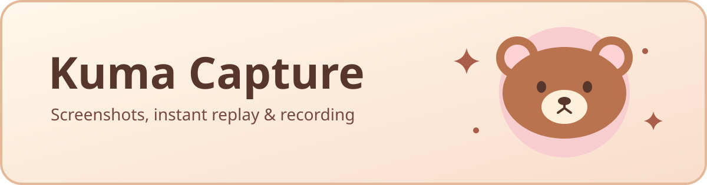

<p align="center">
  
</p>

<h1 align="center">Kuma Capture</h1>

<p align="center">
  A cozy capture app for Windows 11 x64, built in Rust.
</p>

<p align="center">
  <a href="#try-the-windows-build">Try the Windows build</a> ·
  <a href="docs/TESTER.md">Tester checklist</a> ·
  <a href="#build-from-source">Build from source</a>
</p>

## Try the Windows build

**v0.1.0 is an unsigned tester build.** Start with the bundled installer on a clean Windows PC. It includes the OBS capture runtime, rclone, and the Microsoft Visual C++ redistributable.

| Download | How to run it |
| --- | --- |
| **Windows installer** | Run `KumaCaptureSetup.exe`, then open **Kuma Capture** from Start. |
| **Portable ZIP** | Extract the whole ZIP into a writable folder and run `KumaCapture.exe`. The portable build needs the Visual C++ x64 runtime. |

Check [GitHub Releases](../../releases) for published builds, or use the source instructions below.

## Capture what just happened

1. Pick your monitor under **Settings → Clips & Recording**.
2. Choose **Arm replay** on the Capture screen or in the system tray. The default buffer is 30 seconds.
3. Press <kbd>Ctrl</kbd> + <kbd>Shift</kbd> + <kbd>5</kbd> to save the recent footage. Replay keeps running after the clip is saved.

Video always captures the entire selected monitor. Screenshots can capture a region, an active window, one monitor, or the entire desktop.

| Feature | What you can control |
| --- | --- |
| **Screenshots** | PNG or JPEG, JPEG quality, cursor, clipboard actions, and global shortcuts. |
| **Replay and recording** | Buffer length, resolution, FPS, encoder settings, and separate system audio and microphone controls. |
| **Files and folders** | Separate save paths, filename templates, date folders, and a path preview. |
| **Optional uploads** | Named destinations for Google Drive, OneDrive, Dropbox, S3-compatible buckets, WebDAV, SFTP, and custom HTTPS PUT. Uploads are off by default. |
| **Desktop UI** | A custom title bar, tray controls, and settings categories with collapsible Advanced options. |

To connect storage, open **Settings → Uploads → Set up storage…**, then refresh connections and add a destination profile. Captures are saved locally before any upload.

## Build from source

On Windows, install Rust 1.100.0, the MSVC build tools, Python 3.12 or later, and NSIS 3.11 or later. From the repository root:

```powershell
cargo test --locked
cargo build --release --locked
python packaging/package.py --exe target/release/kuma-capture.exe --nsis "${env:ProgramFiles(x86)}\NSIS\makensis.exe"
```

The packager verifies pinned dependencies and writes the installer, portable ZIP, and SHA-256 checksums to `dist/`. See the [Windows workflow](.github/workflows/windows.yml) for the CI build.

## Project status

The Windows x64 cross-build and four automated tests passed. Fullscreen hotkeys, multi-monitor capture, audio sync, Snap Layouts, and live uploads still need hands-on Windows testing. Start with the [tester checklist](docs/TESTER.md) when reporting a problem.

Kuma uses a ShareX-derived screenshot implementation, bundled OBS, and rclone. Separate upstream forks, ShareX `.sxcu` import, video thumbnails, and public-link creation are pending. See the [third-party notes](docs/THIRD-PARTY.md) and [GPL-3.0-or-later license](LICENSE).
