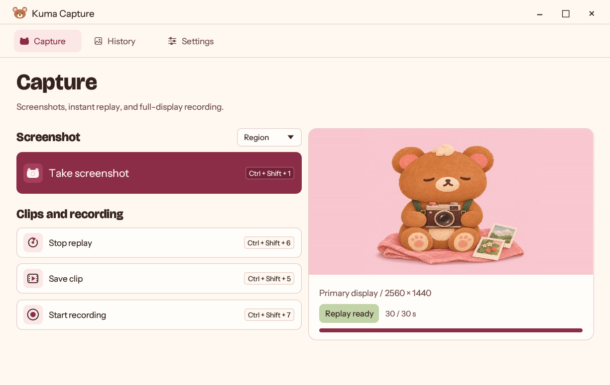

<p align="center">
  
</p>

<h1 align="center">Kuma Capture</h1>

<p align="center">
  <strong>Screenshot it. Clip the last 30 seconds. Keep recording.</strong><br>
  A cozy, tray-first capture app for Windows 11, built in Rust.
</p>

<p align="center">
  <a href="../../releases"><strong>Windows builds</strong></a> ·
  <a href="#quick-start"><strong>Quick start</strong></a> ·
  <a href="docs/TESTER.md"><strong>Tester checklist</strong></a> ·
  <a href="#build-from-source"><strong>Build from source</strong></a>
</p>

<p align="center">
  
  
  
</p>

## The 0.4 desktop redesign

An illustrated Capture workspace, light and dark themes, a thumbnail History with a detail panel, and a standalone updater with download and install progress. The region selector is powered by ShareX.



## For the moments you almost missed

**Instant replay.** Arm a rolling buffer and save the last 15, 30, 60, or 120 seconds with a hotkey. Save another clip whenever you want. The buffer keeps running.

**Screenshots powered by ShareX.** Region capture opens ShareX’s own snipping window with its selection and annotation tools. Window, monitor, and desktop screenshots use ShareX’s engine too. Kuma still handles the output format, clipboard, preview, and chime.

**Full-monitor recording.** Pick a display and record an MP4. Choose your resolution, frame rate, and encoder, with separate controls for system audio and your microphone.

**Files that sort themselves.** Give screenshots, clips, and recordings their own folders. Add date folders or a filename template, and preview the resulting path before saving.

**Storage that follows your workflow.** Keep everything local, use a synced folder or network share, or add destinations for Google Drive, OneDrive, Dropbox, S3-compatible buckets, WebDAV, SFTP, or custom HTTPS PUT. Automatic uploads are optional and run after the local save.

**A little softer around the edges.** The warm bear theme runs from the custom title bar to the tray icon. Settings are grouped by task, with fine-tuning tucked behind **Advanced**.

## Get Kuma Capture

Look for these files under [GitHub Releases](../../releases) when a build is published.

| Package | How to run it |
| --- | --- |
| **`KumaCaptureSetup.exe`** | Recommended on a clean PC. Run the installer, then open Kuma Capture from Start. The installer bundles OBS, rclone, and the Microsoft Visual C++ runtime. |
| **`KumaCapture-Windows-x64.zip`** | Extract the whole ZIP to a writable folder, then run `KumaCapture.exe`. The portable package requires the Microsoft Visual C++ x64 runtime. |

> **Tester builds** · These Windows builds are unsigned. See the release checklist for hands-on verification.

### Updating an existing installation

Run **`KumaCaptureUpdater.exe`** from GitHub Releases or the Start menu. It looks for a newer version, checks the installer download, and installs over the existing app. If your current version is older than 0.3.0, quit it from the tray when the updater asks. Portable users can extract the new ZIP.

## Quick start

1. Pick a monitor under **Settings → Clips & Recording**.
2. Choose **Arm replay** in the app or tray. The default buffer is 30 seconds.
3. Press <kbd>Ctrl</kbd> + <kbd>Shift</kbd> + <kbd>5</kbd> to save a clip. Find it in **History**.

| Default shortcut | Action |
| --- | --- |
| <kbd>Ctrl</kbd> + <kbd>Shift</kbd> + <kbd>1</kbd> | Region screenshot |
| <kbd>Ctrl</kbd> + <kbd>Shift</kbd> + <kbd>2</kbd> | Active window screenshot |
| <kbd>Ctrl</kbd> + <kbd>Shift</kbd> + <kbd>3</kbd> | Monitor screenshot |
| <kbd>Ctrl</kbd> + <kbd>Shift</kbd> + <kbd>4</kbd> | Screenshot all displays |
| <kbd>Ctrl</kbd> + <kbd>Shift</kbd> + <kbd>5</kbd> | Save replay clip |
| <kbd>Ctrl</kbd> + <kbd>Shift</kbd> + <kbd>6</kbd> | Arm or stop replay |
| <kbd>Ctrl</kbd> + <kbd>Shift</kbd> + <kbd>7</kbd> | Start or stop recording |

To change a shortcut, click its binding under **Settings → Hotkeys**, then press a key or a combination like **Ctrl+Shift+K**. Clips and recordings always include the whole selected monitor, including anything visible when switching apps. The microphone starts off.

## Build from source

Install Rust 1.100.0, the MSVC build tools, Python 3.12 or newer, .NET SDK 10.0, and NSIS 3.11 or newer on Windows. Run these commands from the repository root.

```powershell
cargo test --locked
cargo build --release --locked
python packaging/package.py --exe target/release/kuma-capture.exe --updater target/release/kuma-updater.exe --nsis "${env:ProgramFiles(x86)}\NSIS\makensis.exe"
```

The packager verifies dependency checksums and writes the installer, portable ZIP, and SHA-256 checksums to `dist/`. See the [Windows CI workflow](.github/workflows/windows.yml).

## Credits and license

Kuma Capture bundles the upstream [ShareX](https://github.com/ShareX/ShareX) screenshot engine, bundled [OBS Studio](https://github.com/obsproject/obs-studio) for video, and [rclone](https://rclone.org/) for storage. The bear artwork is original to the project. See the [third-party notes](docs/THIRD-PARTY.md) and [GPL-3.0-or-later license](LICENSE).
